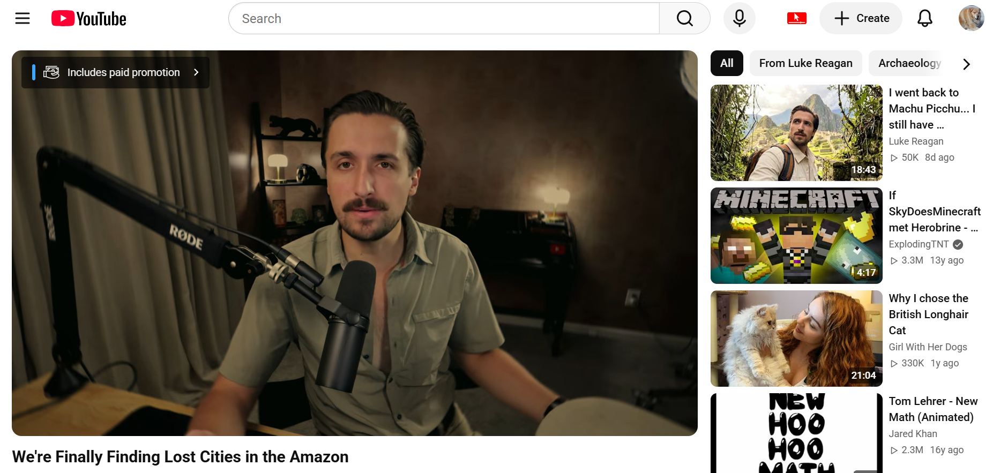

# YouTube Low-View Recommendation Hider

This is a Tampermonkey userscript to hide/block low-view (less than 1,000 by default) YouTube recommendations on any desktop browser.

YouTube tends to force such recommendations into people's feeds, especially near the top of video sidebars, where one almost always appears in the third or fourth slot down. It will continue to do this no matter how many times you do "not interested" or "don't recommend channel" on them, so to eliminate them for good, I created this script. I will update this as-needed, and it will auto-update for you as well.

## Without


## With



## Installation

1. Install Tampermonkey from https://www.tampermonkey.net/
2. Click this link: [YouTube Low-View Recommendation Hider.user.js](https://raw.githubusercontent.com/HenryKredatus/YouTube-Low-View-Recommendation-Hider/main/YouTube%20Low-View%20Recommendation%20Hider.user.js) -Tampermonkey will pop up an install prompt.
3. Click Install.
4. Adjust `VIEW_THRESHOLD` on line 20 if you want a different minimum view count (1,000 by default).

## How it works

YouTube renders recommendation view counts in a few different formats depending on where they appear (sidebar vs. homepage grid) and often puts the actual count only in an `aria-label` attribute rather than the visible text. The script:

1. Scans the page for elements whose visible text or `aria-label` matches a view-count pattern (`"250 views"`, `"1.2K views"`, etc.).
2. Walks up the DOM to find the enclosing recommendation "card" element.
3. If the view count is under the threshold, sets `display: none` on the whole card-removing it from layout entirely so surrounding videos reflow to fill the gap.
4. Uses a `MutationObserver` plus YouTube's internal `yt-navigate-finish` event to keep working as you scroll and navigate between videos without a full page reload (YouTube is a single-page app).

## Debugging

Two flags near the top of the script control console output:

```js
const VERBOSE = true; // logs every hidden video individually
```

Set `VERBOSE = false` for a quieter console. A one-line "loaded" banner and a per-scan summary always print regardless, so you can confirm the script is running.

## NOTE

This may occasionally hide videos you actually want to find as well in places like searches or channel pages if their view count is below your set threshold (although if you're downloading this, I reckon you rarely watch low-view videos to begin with). To see or check for such vids, temporarily turn off the script in the Tampermonkey extension. You can reactivate it from there as well, and it will resume functioning after you close and reopen the browser.
